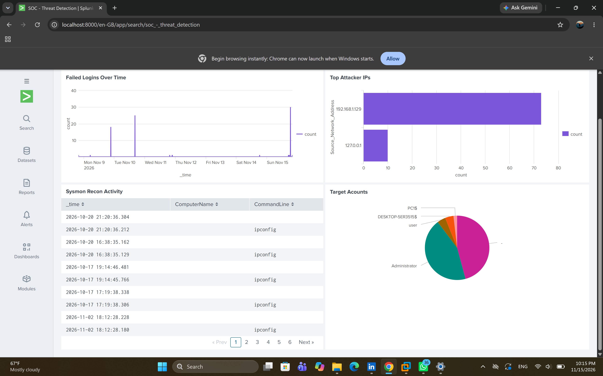
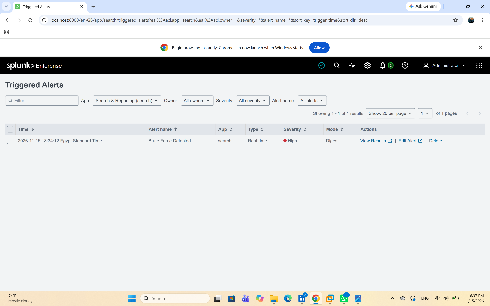

# Splunk SIEM & Threat Detection Lab

## Project Overview
This project demonstrates an end-to-end Security Information and Event Management (SIEM) deployment using Splunk Enterprise. It simulates a real-world attack scenario involving an SMB Brute Force attack and post-exploitation discovery, followed by detection, alerting, and incident response.

## Environment Architecture
- SIEM: Splunk Enterprise (Windows 11)
- Target Endpoint: Windows 10 VM (with Sysmon & Universal Forwarder)
- Attacker Machine: Kali Linux (THC-Hydra)
- Telemetry: Windows Security Logs (EventCode 4625), Sysmon (EventCode 1)

## SOC Dashboard
The Splunk dashboard provides real-time visibility into the attack, tracking failed logins, identifying the attacker's IP, and monitoring post-exploitation commands.

## Attack Simulation & Detection
The attack was simulated using THC-Hydra against the SMB service. Splunk successfully ingested the logs and triggered a high-severity alert based on a tuned correlation rule.

## MITRE ATT&CK Mapping
- T1110.001 - Brute Force: Password Guessing
- T1033 - System Owner/User Discovery
- T1016 - System Network Configuration Discovery

## Engineering Challenge: Sysmon Ingestion Troubleshooting
During the setup, Sysmon logs were not appearing in Splunk despite the service running. 
Root Cause: Windows Notepad appended a hidden .txt extension to the inputs.conf file, preventing Splunk from reading it. Additionally, the Splunk Forwarder lacked Event Log Reader permissions.
Resolution: Renamed the configuration file, granted the NT SERVICE\SplunkForwarder account the necessary permissions, and validated ingestion using the btool utility.

## Repository Structure
- /screenshotsss: Contains visual evidence of the attack, alerts, and dashboard.
- /detections: Contains all SPL queries used in this lab.
- /incident-report: Contains the formal incident report (report.md).
